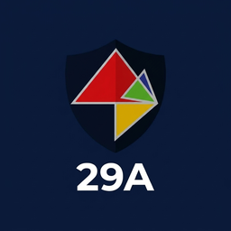

# 29A — Cyber Guardian® Anti-Spyware & Cryptographic Trust Shield

<p align="center">
  
</p>

**Powered by EMON INDUSTRY PVT LTD _29A | Cyber Guardian © 2026**

## Developer & Technical Support Profile
* **Lead Engineer:** Nazmul Hossain
* **Roles:** Computer Science Student • Python Developer • Linux & Cybersecurity Enthusiast
* **Division:** System Architecture & Security Operations — **EMON INDUSTRY PVT LTD _29A**
* **Support Desk:** `secure@emonindustry.bd` (Support Desk v2.1)

---

## Components Included
1. **Android APK App (`android-app/`):** Native Kotlin anti-spyware scanner, Android trust-store auditor (`AndroidCAStore`), proxy detector, developer profile screen, and one-tap Cyber Guardian Root CA installer.
2. **GitHub Pages Web Portal (`docs/index.html`):** Live website with developer profile, APK & certificate downloads, and in-browser Web Crypto SHA-256 certificate verification.
3. **Linux & Termux Security Suite (`app/29a_guard.py` & `scripts/`):** Automated SHA-256 verification (`verify.sh`, `i.sh`, `ca_builder.sh`), trust store installation (`install_ca.sh`), and rogue CA / C2 socket auditing.
4. **Automated GitHub Actions APK & CI Pipeline (`.github/workflows/build-and-deploy.yml`):** Automatically builds the `.apk` on every push and attaches it to GitHub Releases and the website.

## Root CA Cryptographic Profile
| Parameter | Value |
| :--- | :--- |
| **Subject / Issuer DN** | `C=BD, O=EMON INDUSTRY PVT LTD _29A, OU=Cyber Guardian, CN=Cyber Guardian Private Root CA` |
| **Serial Number** | `2E:EF:70:46:EC:AB:EB:9C:49:35:05:A6:B5:00:2C:AD:81:8A:15:DD` |
| **Validity Period** | `05 Nov 2026 – 02 Nov 2036` (3650 days) |
| **Key & Signature** | `RSA 3072-bit` with `SHA-256` (`CA:TRUE`, `keyCertSign`, `cRLSign`) |
| **SHA-256 Fingerprint** | `AA:DF:60:FC:CE:71:CA:A9:72:ED:2A:F8:6C:92:91:AE:66:03:9D:C5:53:B8:05:AF:DC:67:CD:0B:CA:20:6F:7B` |

## Quick Start
```bash
chmod +x scripts/*.sh app/29a_guard.py
./scripts/verify.sh
./scripts/install_ca.sh
python3 app/29a_guard.py
```
